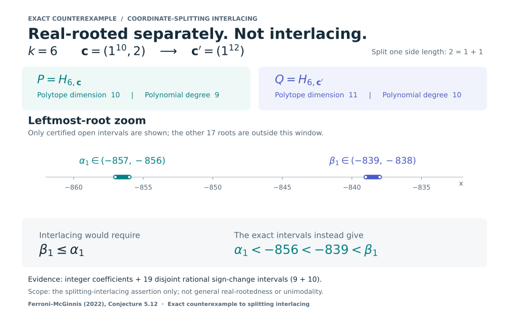

# An exact counterexample to prism-slice splitting interlacing

[中文说明](README.zh-CN.md) · [Complete proof (PDF)](proof/prism_interlacing_counterexample.pdf) · [TeX source](proof/prism_interlacing_counterexample.tex)

**Ferroni–McGinnis (2022), Conjecture 5.12: the coordinate-splitting interlacing clause is false.**
At slice level **k = 6**, split **c = (1¹⁰, 2)** into **c′ = (1¹²)**. The two Ehrhart h*-polynomials have degrees 9 and 10, and both have only simple negative real roots. Their roots **do not interlace**.



## The exact obstruction

Write $P=H_{6,\mathbf c}$ and $Q=H_{6,\mathbf c'}$, where $R_{k,\mathbf c}=\{u:0\le u_i\le c_i,\ \sum u_i=k\}$ and $H$ denotes its Ehrhart $h^*$-polynomial. Their polytope dimensions are **10 and 11**, not their polynomial degrees.

For degrees 9 and 10, interlacing requires the leftmost root of Q to precede that of P. Exact rational sign certificates instead give:

- P: leftmost root in **(−857, −856)**;
- Q: leftmost root in **(−839, −838)**.

There is also a short half-line proof: P(−850) = 1625988474636775883423151 > 0, while Q(−y)/y⁸ ≥ 314407/425 > 0 for y ≥ 850. See the self-contained proof for derivation, exact lattice counts, coefficient arrays, and all nineteen root intervals.

**Scope:** this refutes splitting interlacing, not the separate universal real-rootedness assertion. It does not settle hypersimplex real-rootedness or unimodality, and makes no minimality claim.

## Reproduce offline

Python 3.10+; standard library only; no installation or network required:

```sh
python3 reproduce.py
```

Four standalone verifiers reconstruct lattice counts and check exact certificates using integer/rational arithmetic. The independent audit verifier reconstructs the coefficients without hard-coded expected arrays and discovers its own rational intervals. Do not use Python `-O` or `PYTHONOPTIMIZE`: checks use assertions; the runner rejects optimized execution.

Outputs are under `results/` and `review/certificate.json`. `SHA256SUMS` covers all release files other than itself; after a replay, verify with `sha256sum -c SHA256SUMS`. The log omits machine-specific paths.

## Evidence and limitations

- [Independent mathematical review](review/INDEPENDENT_REVIEW.md): exact derivation and root-separation checks passed. This is AI-assisted research with an automated independent audit, **not human peer review or proof-assistant formalization**.
- [Bounded literature search](review/NOVELTY_LOG.md), 2 November 2026: **no prior refutation found; priority not certified**. Inaccessible, unindexed, and unpublished work remain outside this conclusion.
- [Source citations](SOURCES.md): arXiv v1, v2 and published article all retain the applicable split assertion. Their real-rootedness wording is not literally identical.
- [Provenance](PROVENANCE.json): generated proof retained byte-for-byte; no third-party source PDFs redistributed.
- [License status](LICENSE_STATUS.md): no license grant has been selected for this package.

The proof PDF is the original research note, including its conservative pre-publication wording; the reviews above record the subsequent checks. This release does not imply journal publication, endorsement by the conjecture's authors, or certified priority.
