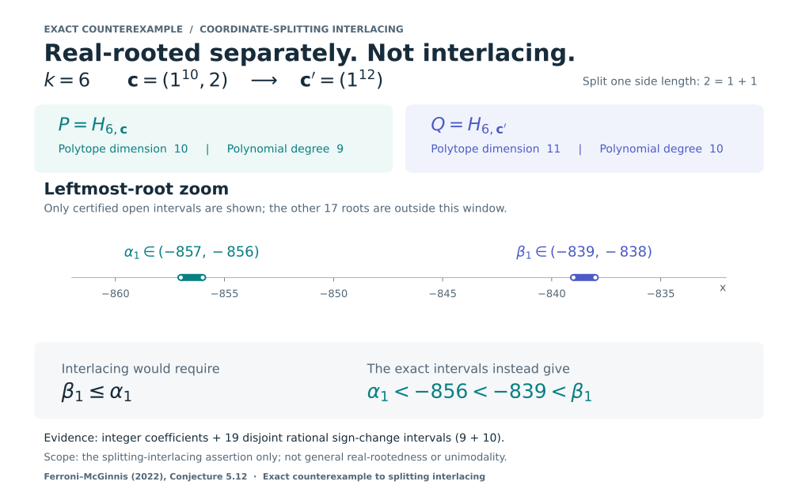

# 棱柱切片坐标拆分交错性的精确反例

[English](README.md) · [完整证明 PDF](proof/prism_interlacing_counterexample.pdf) · [TeX 源文件](proof/prism_interlacing_counterexample.tex)

**Ferroni–McGinnis（2022）猜想 5.12 的坐标拆分交错性部分不成立。**
取 **k = 6**，将 **c = (1¹⁰, 2)** 的最后一个坐标拆成两个 1，得到 **c′ = (1¹²)**。对应的 Ehrhart h* 多项式 P、Q 的次数分别为 9、10，均只有互异负实根，但根不交错。



## 精确证据

多面体为 Rₖ,꜀ = {u：0 ≤ uᵢ ≤ cᵢ，Σuᵢ = k}，维数分别是 **10、11**，不要与 h* 多项式次数混淆。交错要求 Q 的最左根不晚于 P 的最左根，但精确区间为：

- P：**(−857, −856)**；
- Q：**(−839, −838)**。

完整证明还给出半直线证书：P(−850) > 0；对 y ≥ 850，有 Q(−y)/y⁸ ≥ 314407/425 > 0。所有计数、系数及十九个实根区间均以整数或有理数验证，不依赖浮点求根。

**结论边界：只否定坐标拆分交错性，不否定独立的普遍实根性猜想，也不解决所有超单纯形的实根性或单峰性；不声称反例最小。**

## 离线复现

只需 Python 3.10+ 标准库，无需安装依赖或联网：

```sh
python3 reproduce.py
```

四个独立运行的校验脚本重新计算格点数与精确证书。其中独立审计脚本不使用预设 h* 系数，另行搜索有理隔离区间。不要使用 `-O` 或 `PYTHONOPTIMIZE`；入口会拒绝关闭断言的运行方式。

[独立数学审计](review/INDEPENDENT_REVIEW.md)通过；本成果为 AI 辅助研究及自动化独立审计，不是人工同行评议或证明助手形式化。[截至 2026-11-02 的有限文献检索](review/NOVELTY_LOG.md)未找到先前反驳，**不认证首创性或优先权**。不可访问、未索引或未发表工作不在排除范围内。

[原始来源](SOURCES.md)列出预印本两个版本及期刊版；[来源清单](PROVENANCE.json)记录文件哈希。证明 PDF 保留原研究札记及审慎的发表前措辞，后续复核见审计文件。包内不包含第三方论文全文、私人对话或无关探索。发布包尚未选择许可，见 [许可状态](LICENSE_STATUS.md)。
